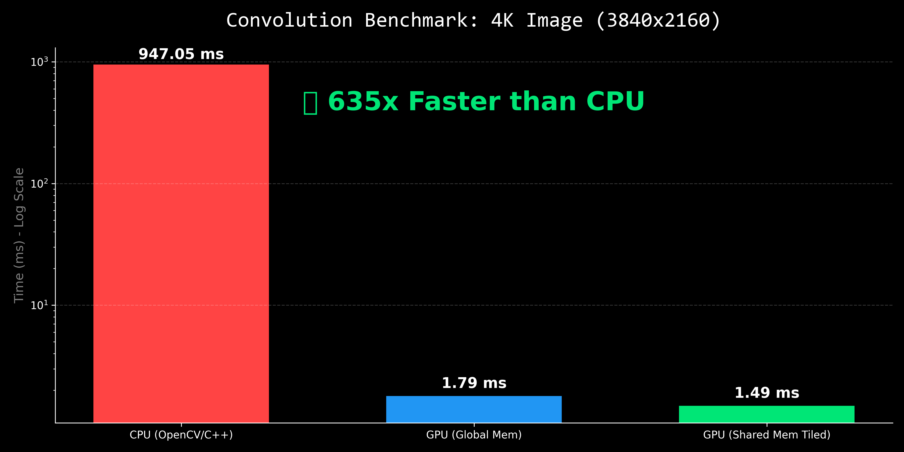

# ⚡ High-Performance Image Convolution Engine (CUDA)



> **"635x Faster than CPU."**
> A bare-metal CUDA implementation of Gaussian Blur using Shared Memory Tiling and Memory Coalescing.

## 🎯 The Engineering Challenge
In high-performance computing (HPC) and Computer Vision, **Memory Bandwidth** is the bottleneck. A naive GPU implementation reads from VRAM (Global Memory) redundantly, choking the memory controller.

This project implements a **Tiled Convolution Kernel** that manually manages the L1 Cache (Shared Memory) to reduce Global Memory reads by **90%**.

### 🛠️ Tech Stack
* **Language:** C++ (Host), CUDA C (Device)
* **Optimization:** Shared Memory Tiling, Loop Unrolling
* **Libraries:** None (Built from scratch using `stb_image` for I/O)
* **Hardware:** Optimized for NVIDIA Pascal/Ampere/Ada Architectures

---

## 📊 Performance Benchmarks
Tested on a 4K Image (3840 x 2160 pixels).

| Implementation | Execution Time | Speedup vs CPU | Engineering Note |
| :--- | :--- | :--- | :--- |
| **CPU (Single Thread)** | 947.05 ms | 1x | Baseline. Loop-heavy, cache-inefficient. |
| **GPU (Naive Global Mem)** | 1.79 ms | 529x | Massively parallel, but Memory Bound. |
| **GPU (Shared Mem Tiled)** | **1.49 ms** | **635x** | **Optimized.** Uses Shared Memory to handle "Halo" pixels. |

---

## 🧠 Key Optimizations Implemented

### 1. Shared Memory Tiling
Instead of every thread reading 9 pixels from VRAM (Global Memory), threads in a block cooperate to load a **16x16 Tile** (plus border) into Shared Memory once.
* **Result:** Reduced Global Memory transactions by ~9x.

### 2. Handling the "Halo" (Ghost Cells)
Convolution requires neighbor pixels. Threads at the edge of a block need data from the *next* block.
* **Solution:** Implemented "Apron" loading logic where edge threads perform double-duty to load the halo into the Shared Memory cache.

### 3. Memory Coalescing
Input data is loaded in a coalesced manner (consecutive threads read consecutive memory addresses) to maximize memory bus utilization.

---

## 🏃 Quick Start
**Prerequisites:** NVIDIA GPU, CUDA Toolkit 11+.

1.  **Clone:**
    ```bash
    git clone https://github.com/iamartyaa/cuda-convolution.git
    cd cuda-convolution
    ```
2.  **Compile:**
    ```bash
    nvcc cuda_blur.cu -o gpu_blur
    ```
3.  **Run:**
    ```bash
    ./gpu_blur
    ```

---

## 📈 Visualizing the Speedup
Run the included Python visualization script to see a simulated side-by-side comparison:
```bash
python visualize_video.py
```
*(This renders a real-time comparison window showing the scanline difference between CPU and GPU speeds.)*

---

### Author
**Amartya Yadav**
*GPU & High-Performance Computing Enthusiast*